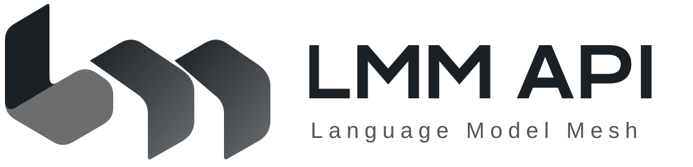

  
  <h1>LMM API</h1>
  
LMM API · 连接模型与工具，让智能自由流动

  

    
    
  

  
<a href="README.md">简体中文</a> · <a href="README_EN.md">English</a>

**LMM = Language Model Mesh，中文「语言模型网络」。** Mesh 寓意互联与协作，体现多模型路由、渠道共享和微服务协作的设计方向。

本分支只有三个可执行程序：`lmm` 客户端、`lmm-core` Rust 核心、`lmm-extensions` Go 扩展。React 控制台单独构建为静态 Web 文件。

**这是全新安装的微服务重构分支，仍为 WIP，不是现有网站的可部署替代品。** 模块测试通过，不代表整站调用、支付和资金链路已接通。不导入旧数据库，不自动升级表结构，不使用旧单体作为运行时回退。

全新核心数据库须显式执行 `lmm-core init-db`；普通启动不建表、不改表。

## 从这里开始

| 任务 | 唯一入口 |
| --- | --- |
| 了解边界与剩余工作 | [架构与状态](docs/core-migration.md) |
| 启动隔离环境 | [Docker 开发栈](deployment/docker/README.md) |
| 使用 mise 开发、测试 | [开发指南](docs/development.md) |
| 配置用户、隐私、退款协议 | [协议模板](docs/legal/README.md) |
| 构建和检查分发包 | [打包与分发](docs/release-architecture.md) |
| 查阅详细接口及历史资料 | [文档目录](docs/README.md) |

## 目录与运行边界

| 程序 | 源码 | 职责 |
| --- | --- | --- |
| `lmm` | `apps/lmm` | 用户客户端，连接服务并调用已提供的功能 |
| `lmm-core` | `apps/lmm-core` | 身份、权限、计费、账本与模型路由；`init-db` 和 `bootstrap-user` 也是这个程序的子命令 |
| `lmm-extensions` | `apps/lmm-extensions` | 商店、工具、助手、运营与支付适配等业务扩展 |

`lmm` 客户端独立维护于 [TokenNotIncluded/lmm](https://github.com/TokenNotIncluded/lmm)，通过 `apps/lmm` Git 子模块固定版本；首次检出运行 `git submodule update --init --depth 1 -- apps/lmm`。客户端使用 Rust，当前能力及 Magpie 对齐进度见[客户端说明](https://github.com/TokenNotIncluded/lmm#readme)。

`apps/web` 输出独立的静态 Web 包，由 Web 服务器提供，不新增可执行程序。`contracts` 保存跨进程契约，`config/legal` 保存可编辑协议草稿，`packaging/distribution.json` 定义各分发包的内容。

核心与扩展使用独立 Compose 项目。更新扩展不应重启核心或其数据库。核心健康接口可响应，不表示模型接口已就绪。当前公共协议读取无需核心服务；其他业务仍须逐项完成接入和验收。

## 贡献与许可证

先阅读 [贡献指南](CONTRIBUTING.md)。漏洞按 [安全指南](SECURITY.md) 报告，不要公开密钥或用户数据。合并、打包、发布和部署需要分别确认；默认检查只生成测试结果或预览包。

项目基于 [QuantumNous/new-api](https://github.com/QuantumNous/new-api) 发展，按 [AGPL-3.0](LICENSE) 发布。保留 [NOTICE](NOTICE)、[FORK.md](FORK.md) 和[第三方许可证](THIRD-PARTY-LICENSES.md)。[线上服务](https://api.lmm.best)与本分支的实现状态不同。
